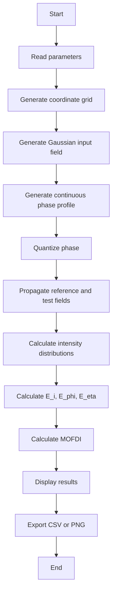

# Algorithm Description

## Processing stages

1. Read model parameters.
2. Generate spatial coordinate grid.
3. Generate Gaussian input beam.
4. Generate continuous phase profile.
5. Quantize the phase profile.
6. Propagate both fields using the angular spectrum method.
7. Calculate intensity distributions.
8. Calculate E_i, E_phi and E_eta.
9. Calculate the overall MOFDI index.
10. Display and export results.

## Algorithm flowchart

## Main algorithms

- Phase profile generation: `make_phase_profile()`
- Phase quantization: `quantize_phase()`
- Angular spectrum propagation: `angular_spectrum()`
- Index calculation: `calculate_index()`
- Simulation: `simulate_pair()`
- Batch experiment: `run_quantization_sweep()`
